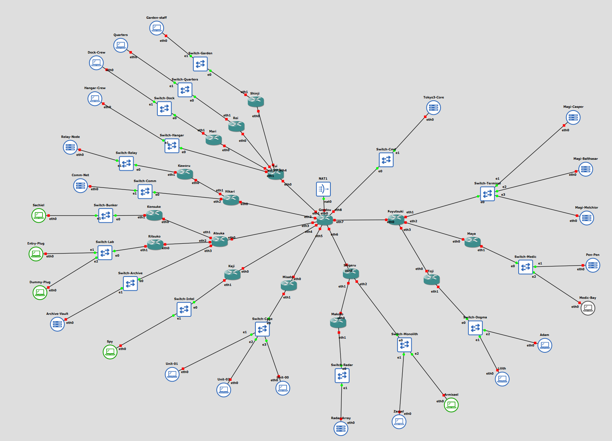
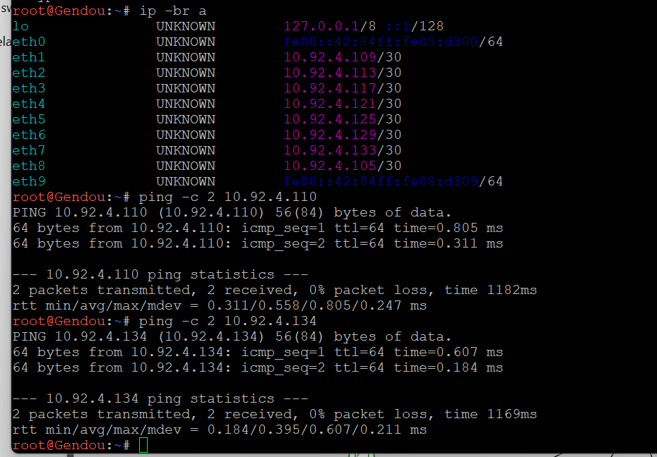
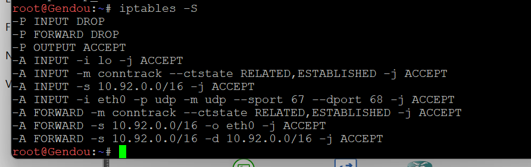
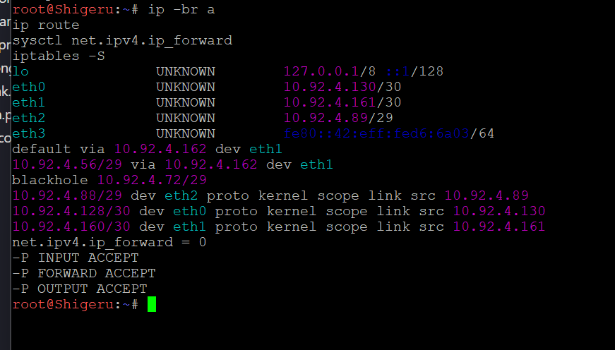
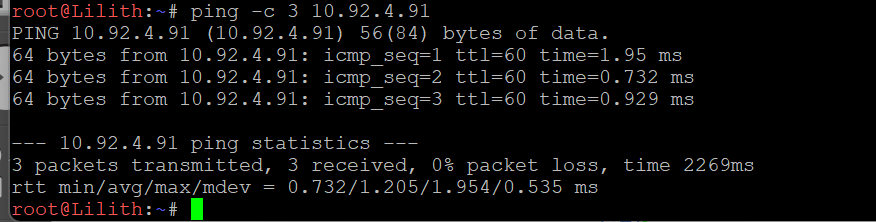

# Laporan Praktikum Modul 5 Jaringan Komputer 2026: Operation Geofront

**Kelompok K-57**

| Anggota (GitHub) | Bagian Pengerjaan |
|---|---|
| RiezW | Soal 1 - 5, Soal 9 - 10, Soal 18 - 20 |
| SDaffAL | Soal 6 - 8, Soal 11 - 17, Boot Hook |

Laporan ini merangkum pengerjaan seluruh soal secara berurutan. Setiap soal berisi apa yang diminta, cara pengerjaan, dan bukti utama. Langkah lengkap, semua perintah, dan seluruh tangkapan layar ada di folder [`Script/`](Script), satu file per soal.

## Daftar Isi

- [Gambaran Umum](#gambaran-umum)
- [Babak 1: Membangun Geofront](#babak-1-membangun-geofront) (Soal 1 - 8)
- [Babak 2: Sabotase dan Hantu MAGI](#babak-2-sabotase-dan-hantu-magi) (Soal 9 - 12)
- [Babak 3: Mengamankan MAGI dan Zona Sensitif](#babak-3-mengamankan-magi-dan-zona-sensitif) (Soal 13 - 19)
- [Babak Final: Siap Dihancurkan, Siap Dibangun Lagi](#babak-final-siap-dihancurkan-siap-dibangun-lagi) (Soal 20)
- [Lampiran: Boot Hook](#lampiran-boot-hook)
- [Struktur Repository](#struktur-repository)

---

## Gambaran Umum

### Topologi



- **Prefix kelompok:** `10.92.0.0/16`, dibagi dengan VLSM menjadi 17 LAN dan 16 link antar-router.
- **Router pusat:** Gendou, satu-satunya router yang terhubung ke NAT1 (internet) dan mendapat IP lewat DHCP.
- **Router cabang:** Yui, Hikari, Atsuka, Kaji, Misato, Shigeru, Fuyutsuki. Di bawahnya ada router leaf (Mari, Rei, Shinji, Kaworu, Kensuke, Ritsuko, Makoto, Maya, Toji).
- **Lingkungan:** project GNS3 berbasis container Docker. Hanya `/root` dan `/etc/network` yang tersimpan saat node di-restart.

### Konvensi Skrip

| Jenis node | Skrip | Keterangan |
|---|---|---|
| Gendou | `/root/gendo.sh` | Nama sesuai Soal 5, disalin juga ke `/root/script.sh` |
| Router lain | `/root/script.sh` | Dijalankan otomatis saat boot lewat `up bash /root/script.sh` di `/etc/network/interfaces` |
| Node non-router | `/root/<nama-node>.sh` | Misalnya `/root/magi-casper.sh`, `/root/pen-pen.sh` |

Setiap soal berikutnya **menambahkan bagian baru** di akhir skrip node (`cat >> ... << 'EOF'`) dengan penanda `# Soal N`, tanpa mengubah bagian sebelumnya. Aturan firewall ditulis agar aman dijalankan berulang kali: chain dibuat dengan `-N` lalu dikosongkan dengan `-F`, dan aturan lama dihapus dengan `-D` sebelum `-A` atau `-I`.

### Alamat Node Penting

| Node | IP | Gateway | Dipakai di Soal |
|---|---|---|---|
| Magi-Casper | 10.92.4.66/29 | 10.92.4.65 (Fuyutsuki) | 7, 11, 12, 17, 18, 20 |
| Magi-Balthasar | 10.92.4.67/29 | 10.92.4.65 | 7, 11, 13 |
| Magi-Melchior | 10.92.4.68/29 | 10.92.4.65 | 7, 13 |
| Unit-01 / Unit-02 / Unit-00 | 10.92.4.74 - .76/29 | 10.92.4.73 (Misato) | 6, 10, 12, 13, 14 |
| Lilith / Adam | 10.92.4.82 - .83/29 | 10.92.4.81 (Toji) | 3, 4, 7, 8, 9, 11, 13, 14, 15, 18, 19 |
| Zeruel / Armisael | 10.92.4.90 - .91/29 | 10.92.4.89 (Shigeru) | 3, 4, 5, 9, 17, 18, 19 |
| Pen-Pen | 10.92.3.195/27 | 10.92.3.193 (Maya) | 8, 14, 17 |
| Sachiel | 10.92.3.130/26 | 10.92.3.129 | 3, 13, 14 |
| Entry-Plug / Dummy-Plug | 10.92.4.50 - .51/29 | 10.92.4.49 (Ritsuko) | 14, 16 |
| Spy | 10.92.4.102/30 | 10.92.4.101 (Kaji) | 10, 14 |
| Tokyo3-Core | 10.92.4.106/30 | 10.92.4.105 (Gendou) | 8, 15, 16 |

---

## Babak 1: Membangun Geofront

### Soal 1: Markas Tanpa Peta (VLSM)

**Yang diminta:** membagi `10.92.0.0/16` dengan VLSM untuk 17 LAN dan 16 link antar-router, urut dari kebutuhan terbesar, lengkap dengan tabel, pohon IP, dan 5 subnet jalur Dummy-Plug ke Armisael yang dilingkari.

**Pengerjaan:**

1. LAN dan link diurutkan dari kebutuhan IP terbesar. Jika sama, LAN didahulukan.
2. Setiap subnet memakai prefix terkecil yang muat.
3. Alamat diisi berurutan: network, gateway (IP usable pertama), IP terpakai, broadcast, dan sisa.

Tabel pembagian IP:


Pohon IP, dengan 5 subnet jalur Dummy-Plug ke Armisael dilingkari merah:


**Contoh hitungan (Switch-Lab):** kebutuhan Entry-Plug (3) + Dummy-Plug (2) + gateway Ritsuko (1) = 6 IP usable. Blok /30 hanya memberi 2 IP usable (kurang), blok /29 memberi 6 (cukup), sehingga dipakai **/29 (255.255.255.248)**. Subnet sebelumnya berakhir di `10.92.4.47`, maka:

| Network | Gateway | IP Terpakai | Broadcast | Sisa |
|---|---|---|---|---|
| 10.92.4.48 | 10.92.4.49 | 10.92.4.49 - 10.92.4.51 | 10.92.4.55 | 10.92.4.52 - 10.92.4.54 |

Detail: [Script/soal1.md](Script/soal1.md)

### Soal 2: Geofront Gelap Gulita (IP Router dan IP Forwarding)

**Yang diminta:** memberi IP ke semua interface router sesuai Soal 1, mengaktifkan IP forwarding, dan hanya Gendou yang mendapat IP dari NAT1 lewat DHCP.

**Pengerjaan:** setiap router mendapat `/root/script.sh`. Contoh router cabang Yui:

```bash
#!/bin/bash
sysctl -w net.ipv4.ip_forward=1
for i in eth0 eth1 eth2 eth3 eth4; do
    ip addr flush dev $i
    ip link set dev $i up
done
ip addr add 10.92.4.110/30 dev eth0
ip addr add 10.92.3.1/25 dev eth1
ip addr add 10.92.4.137/30 dev eth2
ip addr add 10.92.4.141/30 dev eth3
ip addr add 10.92.4.145/30 dev eth4
```

Agar skrip berjalan otomatis setiap GNS3 dinyalakan, `/etc/network/interfaces` router diberi baris:

```text
auto eth0
iface eth0 inet manual
    up bash /root/script.sh
```

**Bukti:** `ip -br a` di router dan ping kedua ujung setiap link router ke router.



Detail: [Script/soal2.md](Script/soal2.md)

### Soal 3: Pulau-Pulau yang Terpisah (Routing Statis)

**Yang diminta:** menghubungkan semua subnet dengan routing statis dan rute sesedikit mungkin. Router selain Gendou hanya punya satu default route ke atas dan rute untuk subnet di bawahnya. Subnet satu cabang yang bisa digabung harus diringkas.

**Pengerjaan:**

- **Router leaf** cukup satu default route ke router induk, misalnya Mari: `ip route replace default via 10.92.4.137`.
- **Router cabang** memiliki default route ke Gendou dan rute ke subnet di bawahnya. Contoh Yui:

```bash
ip route replace default via 10.92.4.109
ip route replace 10.92.4.32/28 via 10.92.4.138
ip route replace 10.92.0.0/23 via 10.92.4.142
ip route replace 10.92.4.0/27 via 10.92.4.146
```

- **Gendou** memiliki rute ke semua subnet per cabang. Link Atsuka ke Kensuke dan Ritsuko (`10.92.4.152/30` dan `10.92.4.156/30`) diringkas menjadi satu rute `10.92.4.152/29`.
- Host uji (Armisael, Lilith, Sachiel, Comm-Net) diberi IP sementara dengan `ip addr add` dan `ip route add default`.

**Bukti:** Armisael bisa ping Lilith, Sachiel, dan Comm-Net.


Detail: [Script/soal3.md](Script/soal3.md)

### Soal 4: Haus Kabar dari Dunia Luar (NAT)

**Yang diminta:** seluruh jaringan bisa ke internet lewat Gendou, konfigurasi tidak berubah saat IP NAT1 berganti, hanya traffic internal yang keluar lewat NAT1 yang diterjemahkan, dan node bisa me-resolve domain.

**Pengerjaan** di Gendou:

```bash
iptables -t nat -F POSTROUTING
iptables -t nat -A POSTROUTING -s 10.92.0.0/16 -o eth0 -j MASQUERADE
```

- **`MASQUERADE`** memakai IP `eth0` saat itu juga, sehingga tidak perlu diubah ketika IP dari DHCP NAT1 berganti.
- **`-s 10.92.0.0/16 -o eth0`** membuat hanya traffic internal yang keluar ke NAT1 yang diterjemahkan. Traffic antar-LAN tidak keluar lewat `eth0`, sehingga tetap membawa alamat asli.
- Node uji diberi DNS dengan `echo "nameserver 8.8.8.8" > /etc/resolv.conf`.

**Bukti:** ping `8.8.8.8` dan `deb.debian.org` dari Armisael dan Lilith, serta counter rule NAT.


Detail: [Script/soal4.md](Script/soal4.md)

### Soal 5: Pintu Depan Dikunci Rapat (Firewall Gendou)

**Yang diminta:** policy `INPUT` dan `FORWARD` Gendou menjadi `DROP`, lalu hanya mengizinkan balasan koneksi, traffic internal ke internet, traffic antar-LAN, traffic internal ke Gendou, loopback, dan DHCP dari NAT1. Semua ditulis di `gendo.sh`.

**Pengerjaan:** bagian firewall ditambahkan ke `/root/gendo.sh`:

```bash
iptables -F; iptables -X
iptables -P INPUT DROP
iptables -P FORWARD DROP
iptables -P OUTPUT ACCEPT

iptables -A INPUT -i lo -j ACCEPT
iptables -A INPUT -m conntrack --ctstate ESTABLISHED,RELATED -j ACCEPT
iptables -A INPUT -s 10.92.0.0/16 -j ACCEPT
iptables -A INPUT -i eth0 -p udp --sport 67 --dport 68 -j ACCEPT

iptables -A FORWARD -m conntrack --ctstate ESTABLISHED,RELATED -j ACCEPT
iptables -A FORWARD -s 10.92.0.0/16 -o eth0 -j ACCEPT
iptables -A FORWARD -s 10.92.0.0/16 -d 10.92.0.0/16 -j ACCEPT
```

Koneksi baru dari sisi NAT1 tidak cocok dengan aturan mana pun, sehingga jatuh ke policy `DROP`.

**Bukti:** `iptables -S` di Gendou dan ping `8.8.8.8` dari Armisael tetap berhasil.




Detail: [Script/soal5.md](Script/soal5.md)

### Soal 6: Alamat Para Pilot (IP Statis Node Non-Router)

**Yang diminta:** IP statis dan gateway untuk 25 node non-router sesuai aturan glosarium, dan harus bertahan setelah restart.

**Pengerjaan:** setiap node mendapat `/root/<nama-node>.sh` yang (1) menulis `/etc/network/interfaces` agar dipasang ulang otomatis saat boot, dan (2) langsung memasang IP dengan perintah `ip`. Contoh Unit-01:

```bash
#!/bin/sh
IP=10.92.4.74; PFX=29; MASK=255.255.255.248; GW=10.92.4.73
cat > /etc/network/interfaces << EON
auto lo
iface lo inet loopback

auto eth0
iface eth0 inet static
    address $IP
    netmask $MASK
    gateway $GW
    up echo nameserver 8.8.8.8 > /etc/resolv.conf
EON
ip addr flush dev eth0
ip addr add $IP/$PFX dev eth0
ip link set eth0 up
ip route replace default via $GW
echo nameserver 8.8.8.8 > /etc/resolv.conf
```

Gateway adalah IP usable pertama subnet. Node dalam satu switch mendapat IP berikutnya sesuai urutan dari kiri ke kanan pada gambar topologi.

**Bukti:** `ip -br a` dan ping ke gateway di Unit-01, sebelum dan sesudah restart.


Ke-25 IP node juga diuji dari Gendou dan semuanya menjawab:


Detail: [Script/soal6.md](Script/soal6.md)

### Soal 7: Membangunkan MAGI

**Yang diminta:** memasang `iptables` dan `netcat-traditional` di ketiga MAGI lewat skrip node, menyalakan listener (Casper 5000, Balthasar 5000 dan 5001, Melchior 5000), lalu mengirim pesan dari Lilith.

**Pengerjaan:** bagian Soal 7 ditambahkan ke `/root/magi-<nama>.sh`:

```bash
apt-get update
apt-get install -y iptables netcat-traditional
update-alternatives --set nc /bin/nc.traditional
cat > /root/listener.sh << 'EOL'
#!/bin/sh
# pakai: sh /root/listener.sh PORT
while true; do
    nc -l -p $1 >> /root/pesan-$1.txt
    sleep 1
done
EOL
nohup sh /root/listener.sh 5000 > /dev/null 2>&1 &
```

- Image node memakai netcat-openbsd sebagai bawaan, sehingga `update-alternatives` diperlukan agar `nc` mengarah ke netcat-traditional.
- Loop `while true` membuka listener lagi setelah satu klien selesai, dan semua pesan ditambahkan ke `/root/pesan-PORT.txt`.

**Bukti:** pesan dari Lilith diterima di setiap node, termasuk port 5001 Balthasar.


Detail: [Script/soal7.md](Script/soal7.md)

### Soal 8: Mengenali Kondisi Normal

**Yang diminta:** Pen-Pen dan Tokyo3-Core menjawab port 80 dengan `Welcome to {hostname}`, Tokyo3-Core port 8080 menjawab `syifa imutz`, dan port yang tidak dilayani (misalnya 22) langsung gagal.

**Pengerjaan:** layanan sederhana dibuat dengan `/root/web.sh`:

```bash
#!/bin/sh
# pakai: sh /root/web.sh PORT "PESAN"
while true; do
    nc -l -p $1 -c "echo '$2'"
    sleep 0.2
done
```

```bash
nohup sh /root/web.sh 80 "Welcome to $(hostname)" > /dev/null 2>&1 &
nohup sh /root/web.sh 8080 "syifa imutz" > /dev/null 2>&1 &   # hanya Tokyo3-Core
```

**Bukti:** `nc` dari Lilith ke ketiga port menjawab sesuai soal, dan port 22 langsung `Connection refused` (sekitar 0.005 detik) karena kernel server membalas `RST` ketika tidak ada program yang mendengarkan port tersebut.


Detail: [Script/soal8.md](Script/soal8.md)

---

## Babak 2: Sabotase dan Hantu MAGI

Pada soal sabotase (Soal 9, 10, dan 12), skrip dari asisten dijalankan **tanpa membaca isinya**. Penyebab dicari dari gejala dan diagnosis, lalu diperbaiki.

### Soal 9: Jalur Belakang Diutak-atik (`break_routing.sh` di Shigeru)

**Gejala:** Lilith tidak mendapat jawaban dari Armisael, padahal Armisael masih bisa ping gateway-nya sendiri.


**Diagnosis** di Shigeru (`ip -br a`, `ip route`, `sysctl net.ipv4.ip_forward`, `ip rule`, `iptables -S`):



**Penyebab yang ditemukan:**

| Temuan | Akibat |
|---|---|
| `net.ipv4.ip_forward = 0` | Shigeru tidak meneruskan paket antar-interface. Ping Armisael ke `10.92.4.89` tetap berhasil karena alamat itu milik Shigeru sendiri |
| Default route ke Makoto (`10.92.4.162`), bukan Gendou | Balasan ke jaringan lain dikirim ke arah yang salah |
| Rute `blackhole 10.92.4.72/29` | Paket ke Switch-Cage dibuang tanpa pesan kesalahan |
| `ip rule` `from all iif eth2 lookup 100` | Paket dari `eth2` (arah Armisael) memakai tabel 100, sehingga balasan tidak menemukan jalan kembali |

**Perbaikan:**

```bash
ip route del blackhole 10.92.4.72/29
ip rule del iif eth2 lookup 100
ip route flush table 100
bash /root/script.sh     # aktifkan lagi ip_forward dan kembalikan default route ke Gendou
```

**Bukti:** Lilith bisa ping Armisael kembali.



Detail: [Script/soal9.md](Script/soal9.md)

### Soal 10: Para Pilot Terkunci di Dalam (`break_nat.sh` di Misato dan Gendou)

**Gejala:** Unit-01, Unit-02, dan Unit-00 tidak bisa ping `8.8.8.8`, tetapi ping ke Lilith normal. Spy di Switch-Intel tidak terdampak.


**Diagnosis** tabel NAT di Misato dan Gendou:


**Penyebab yang ditemukan:**

| Lokasi | Aturan | Akibat |
|---|---|---|
| Misato | `-A POSTROUTING -s 10.92.4.72/29 ! -d 10.92.0.0/16 -o eth0 -j SNAT --to-source 172.31.99.1` | Paket Switch-Cage ke luar jaringan internal diubah sumbernya menjadi `172.31.99.1`. Gendou hanya meneruskan sumber `10.92.0.0/16`, sehingga paket dibuang. Ke Lilith tetap berhasil karena tujuannya di dalam `10.92.0.0/16` |
| Gendou | `-A POSTROUTING -s 10.92.4.64/29 -o eth0 -j RETURN` | Traffic Switch-Terminal (MAGI) melewati aturan MASQUERADE, sehingga keluar ke NAT1 tanpa diterjemahkan |

Spy tidak terdampak karena berada di belakang Kaji, bukan di subnet Switch-Cage.

**Perbaikan:**

```bash
# Misato
iptables -t nat -D POSTROUTING -s 10.92.4.72/29 ! -d 10.92.0.0/16 -o eth0 -j SNAT --to-source 172.31.99.1
# Gendou
iptables -t nat -D POSTROUTING -s 10.92.4.64/29 -o eth0 -j RETURN
```

**Bukti:** Unit-01 kembali bisa ping `8.8.8.8`.


Detail: [Script/soal10.md](Script/soal10.md)

### Soal 11: Casper Harus Jadi Hantu

**Yang diminta:** tidak ada perangkat yang boleh mem-ping Magi-Casper, termasuk tetangga satu switch, sedangkan Casper tetap boleh mem-ping siapa saja dan TCP 5000 tetap hidup.

**Pengerjaan:** aturan dipasang **di Casper sendiri**, karena ping dari Balthasar (satu switch) tidak pernah melewati router.

```bash
iptables -D INPUT -p icmp --icmp-type echo-request -j DROP 2>/dev/null
iptables -A INPUT -p icmp --icmp-type echo-request -j DROP
```

Hanya `echo-request` (ping yang datang) yang dibuang. Balasan ping milik Casper bertipe `echo-reply`, sehingga ping keluar tetap berhasil.

**Bukti:** ping dari Balthasar dan Lilith ke Casper gagal, ping dari Casper ke keduanya berhasil.


Detail: [Script/soal11.md](Script/soal11.md)

### Soal 12: Teknisi yang Kelewat Semangat (`break_fw.sh` di Casper)

**Gejala:** Casper tidak bisa ping `8.8.8.8` dan tidak bisa `apt-get update`, Unit-00 tidak bisa tersambung ke TCP 5000 Casper (menggantung lalu timeout). Ping ke Casper tetap ditolak.


`break_fw.sh` diunduh langsung di Casper dan hanya ukuran serta dua karakter pertamanya (`#!`) yang diperiksa, sehingga isinya tidak terbaca.

**Diagnosis:** tabel `nat`, `mangle`, `raw`, rute, DNS, dan listener normal. Masalah ada di tabel `filter`:


| Temuan | Akibat |
|---|---|
| `-P INPUT DROP` tanpa aturan `ESTABLISHED,RELATED` | Balasan untuk koneksi yang dimulai Casper (ping, DNS, HTTP) ikut terbuang |
| `-A INPUT -p icmp -j DROP` | Semua ICMP dibuang, termasuk `echo-reply` untuk ping keluar Casper |
| `-A OUTPUT -p udp --dport 53 -j DROP` | Query DNS keluar diblokir, sehingga `apt-get` tidak bisa me-resolve `deb.debian.org` |
| Tidak ada `ACCEPT` untuk TCP 5000 | Koneksi Unit-00 jatuh ke policy DROP dan menggantung |

**Perbaikan** (policy INPUT tetap DROP):

```bash
iptables -P INPUT DROP
iptables -F INPUT
iptables -F OUTPUT
iptables -A INPUT -i lo -j ACCEPT
iptables -A INPUT -m conntrack --ctstate ESTABLISHED,RELATED -j ACCEPT
iptables -A INPUT -p icmp --icmp-type echo-request -j DROP
iptables -A INPUT -p tcp --dport 5000 -j ACCEPT
```

**Bukti:** `nc` dari Unit-00 ke Casper port 5000 berhasil, `apt-get update` di Casper berhasil, dan ping ke Casper tetap ditolak.


Detail: [Script/soal12.md](Script/soal12.md)

---

## Babak 3: Mengamankan MAGI dan Zona Sensitif

### Soal 13: Brankas Balthasar

**Yang diminta:** hanya Casper dan semua Pilot (Unit-01/02/00 dan Sachiel) yang boleh tersambung ke TCP 5000 dan 5001 Balthasar. Node lain langsung ditolak, bukan menggantung. Lalu lintas lain tidak terganggu.

**Pengerjaan** di Balthasar (Melchior satu switch, sehingga tidak bisa dicegat di router):

```bash
iptables -N BRANKAS 2>/dev/null; iptables -F BRANKAS
M="-p tcp -m multiport --dports 5000,5001"
iptables -D INPUT $M -j BRANKAS 2>/dev/null
iptables -A INPUT $M -j BRANKAS
iptables -A BRANKAS -s 10.92.4.66 -j ACCEPT
iptables -A BRANKAS -m iprange --src-range 10.92.4.74-10.92.4.76 -j ACCEPT
iptables -A BRANKAS -s 10.92.3.130 -j ACCEPT
iptables -A BRANKAS -p tcp -j REJECT --reject-with tcp-reset
```

`REJECT --reject-with tcp-reset` membalas dengan `RST`, sehingga klien langsung mendapat `Connection refused`, berbeda dengan `DROP` yang membuat klien menunggu timeout.

**Bukti:** Unit-01 berhasil ke kedua port, Lilith dan Melchior ditolak seketika (sekitar 0.003 detik).


Detail: [Script/soal13.md](Script/soal13.md)

### Soal 14: Jam Kunjungan Sang Pinguin

**Yang diminta:** ping dan TCP 80 ke Pen-Pen hanya boleh sesuai jadwal, tanpa mengubah jam komputer. Jadwal disimpan sebagai variabel di awal skrip Pen-Pen.

| Kelompok | Anggota | Jadwal (WIB) |
|---|---|---|
| Pilot | Unit-01/02/00, Sachiel | 08.00 - 16.00, Senin - Jumat |
| Staf Geofront | Lilith, Adam | 17.00 - 23.00, setiap hari |
| Terduga Dummy System | Entry-Plug, Dummy-Plug, Spy | Selalu ditolak |
| Lainnya | Node lain | Bebas |

**Pengerjaan:**

- Variabel `PILOT_START`, `PILOT_STOP`, `PILOT_DAYS`, `STAF_START`, dan `STAF_STOP` disisipkan tepat setelah `#!/bin/sh` di `/root/pen-pen.sh`.
- Chain `JADWAL` menerima `echo-request` dan TCP 80. Terduga selalu `REJECT`, Pilot dan Staf `ACCEPT` dengan match `time` di dalam jadwal dan `REJECT` di luar jadwal.
- Match `time` membaca jam **UTC**, sehingga fungsi `utc` mengurangi 7 jam dari WIB. Jika jadwal dimulai sebelum 07.00 WIB, fungsi `geser` memundurkan daftar hari satu hari karena hari UTC masih hari sebelumnya.


**Bukti:** pengujian dengan jadwal yang **cocok** dengan jam sekarang (Unit-01 dan Lilith berhasil, Spy ditolak) dan jadwal asli yang **tidak cocok** (ketiganya ditolak).


Detail: [Script/soal14.md](Script/soal14.md)

### Soal 15: Banjir Ping di Pusat Komando

**Yang diminta:** Tokyo3-Core hanya menjawab maksimal 5 ping per detik dan membuang kelebihannya, tanpa mengganggu ping di bawah batas dan tanpa membatasi ping yang dikirim Tokyo3-Core sendiri.

**Pengerjaan** di Tokyo3-Core:

```bash
iptables -N BATASPING 2>/dev/null; iptables -F BATASPING
P="-p icmp --icmp-type echo-request"
iptables -D INPUT $P -j BATASPING 2>/dev/null
iptables -I INPUT 1 $P -j BATASPING
iptables -A BATASPING -m limit --limit 5/second --limit-burst 5 -j ACCEPT
iptables -A BATASPING -j DROP
```

Hanya `echo-request` yang masuk chain, dan lompatannya dipasang di posisi pertama `INPUT` agar tidak didahului aturan lain.

**Bukti:** ping rapat dari Lilith (`ping -i 0.1 -c 50`) kehilangan 40% paket, dengan counter **30 ACCEPT dan 20 DROP**. Ping biasa setelah jeda 3 detik semuanya berhasil.


Detail: [Script/soal15.md](Script/soal15.md)

### Soal 16: Pencuri yang Mencoba Setiap Pintu

**Yang diminta:** setiap koneksi TCP dari Dummy-Plug ke port 22, 23, dan 3306 di Tokyo3-Core dicatat dengan prefix `SCAN-NERV:` lalu ditolak seketika. Port 80 dan 8080 tetap bisa diakses.

**Pengerjaan** di Tokyo3-Core:

```bash
iptables -N SCANNERV 2>/dev/null; iptables -F SCANNERV
S="-s 10.92.4.51 -p tcp -m multiport --dports 22,23,3306"
iptables -D INPUT $S -j SCANNERV 2>/dev/null
iptables -A INPUT $S -j SCANNERV
iptables -A SCANNERV -j LOG --log-prefix "SCAN-NERV: "
iptables -A SCANNERV -p tcp -j REJECT --reject-with tcp-reset
```

Target `LOG` tidak menghentikan paket, sehingga paket lanjut ke `REJECT`. Urutannya harus `LOG` lalu `REJECT`.

**Bukti:** ketiga port ditolak seketika, port 80 dan 8080 berhasil, dan counter `LOG` serta `REJECT` masing-masing mencatat 3 paket.


Detail: [Script/soal16.md](Script/soal16.md)

### Soal 17: Sihir Hitam di Jalur Paket

**Yang diminta:** di Fuyutsuki (gateway Switch-Terminal), setiap koneksi TCP dari Casper ke Zeruel dialihkan ke Pen-Pen. Casper tidak boleh sadar dan ping tidak dialihkan.

**Pengerjaan:** bagian ini ditambahkan ke `/root/script.sh` Fuyutsuki:

```bash
apt-get install -y conntrack
R="-s 10.92.4.66 -d 10.92.4.90 -p tcp -j DNAT --to-destination 10.92.3.195"
iptables -t nat -D PREROUTING $R 2>/dev/null
iptables -t nat -A PREROUTING $R
```

- **DNAT di `PREROUTING`** mengubah tujuan paket sebelum keputusan routing, sehingga paket diteruskan ke arah Pen-Pen.
- **Connection tracking** mengembalikan alamat sumber balasan menjadi Zeruel, sehingga Casper tidak sadar.
- **`-p tcp`** membuat ping (ICMP) tetap sampai ke Zeruel.

**Bukti:** pesan Casper ke IP Zeruel port 9000 muncul di Pen-Pen, file Zeruel kosong, dan tabel `conntrack` menunjukkan arah permintaan `dst=10.92.4.90` dengan arah balasan `src=10.92.3.195`.


Detail: [Script/soal17.md](Script/soal17.md)

### Soal 18: Gerbang Monolith dan Radar

**Yang diminta:** Shigeru melindungi zona Monolith dan Radar. Node di dalam zona boleh memulai koneksi ke mana saja, node di luar tidak boleh memulai koneksi ke dalam, kecuali ping dari subnet Terminal. Penolakan berdasarkan arah datang, tanpa menulis subnet luar satu per satu.

**Pengerjaan:** bagian ini ditambahkan ke `/root/script.sh` Shigeru:

```bash
iptables -N GERBANG 2>/dev/null; iptables -F GERBANG
iptables -D FORWARD -j GERBANG 2>/dev/null
iptables -I FORWARD 1 -j GERBANG
iptables -A GERBANG -m conntrack --ctstate ESTABLISHED,RELATED -j ACCEPT
iptables -A GERBANG -i eth0 -s 10.92.4.64/29 -p icmp --icmp-type echo-request -j ACCEPT
iptables -A GERBANG -i eth0 -j DROP
```

`-i eth0` (sisi Shigeru yang menghadap Gendou) menangkap semua yang datang dari luar zona, termasuk subnet baru di kemudian hari.

**Bukti:** ping Casper ke Zeruel berhasil, ping Lilith ke Zeruel gagal, dan Zeruel tetap bisa ping ke luar.


Detail: [Script/soal18.md](Script/soal18.md)

### Soal 19: Hukuman untuk Sang Pengkhianat

**Yang diminta:** Armisael diisolasi total (termasuk ke gateway dan tetangga satu switch) tanpa ikut memblokir Zeruel, dan isolasi tidak boleh dikerjakan di dalam Armisael.

**Pengerjaan** dalam dua lapis:

1. **Layer 2:** pada **Switch-Monolith** (Configure di GNS3), port 2 (Armisael) dipindah ke VLAN `99`, sedangkan port 0 dan 1 tetap di VLAN `1`. Armisael tidak lagi satu broadcast domain dengan Zeruel maupun Shigeru.


2. **Layer 3:** chain `ISOLASI` di Shigeru pada `INPUT`, `OUTPUT`, dan `FORWARD`:

```bash
iptables -N ISOLASI 2>/dev/null; iptables -F ISOLASI
for c in INPUT OUTPUT FORWARD; do
  iptables -D $c -j ISOLASI 2>/dev/null
  iptables -I $c 1 -j ISOLASI
done
iptables -A ISOLASI -s 10.92.4.91 -j DROP
iptables -A ISOLASI -d 10.92.4.91 -j DROP
```

**Bukti:** dengan listener TCP 9000 di Armisael, Zeruel, dan Lilith (serta TCP 53 untuk Seele `8.8.8.8`), semua `ping` dan `nc` dari Armisael gagal, sedangkan dari Zeruel berhasil.


Detail: [Script/soal19.md](Script/soal19.md)

---

## Babak Final: Siap Dihancurkan, Siap Dibangun Lagi

### Soal 20: Uji Kebakaran Geofront

**Yang diminta:** memilih tiga node (minimal satu router), menyimpan rule dengan `iptables-save`, menghapus semua rule (termasuk tabel `nat`) dan rute buatan sendiri, lalu memulihkan dengan `iptables-restore` dan skrip node **dua kali berturut-turut**. Hasilnya harus sama dan tidak ada rule maupun rute yang dobel.

**Node yang dipilih:**

| Node | Jenis | Isi yang diuji |
|---|---|---|
| Shigeru | Router | Chain `GERBANG` (Soal 18) dan `ISOLASI` (Soal 19), rute statis |
| Fuyutsuki | Router | DNAT `PREROUTING` (Soal 17), rute statis |
| Magi-Casper | Host | Policy `INPUT DROP` dan aturan Soal 11 - 12, default route |

**Pengerjaan** di setiap node:

```bash
# 1. Simpan
iptables-save > /root/<nama>.rules

# 2. Hancurkan
iptables -P INPUT ACCEPT; iptables -P FORWARD ACCEPT; iptables -P OUTPUT ACCEPT
iptables -F; iptables -X
iptables -t nat -F; iptables -t nat -X
ip route del default; ip route del <rute buatan sendiri>

# 3. Pulihkan dua kali berturut-turut
iptables-restore < /root/<nama>.rules
bash /root/<nama>.sh
echo "Pemulihan N -> filter: $(iptables -S | wc -l) baris | nat: $(iptables -t nat -S | wc -l) baris"
```

Pemulihan aman diulang karena setiap bagian skrip menghapus aturan lama sebelum menambahkannya lagi (`-F` pada chain buatan, `-D` sebelum `-A`/`-I`), dan rute ditulis dengan `ip route replace`, bukan `add`.

**Hasil jumlah baris:**

| Node | Pemulihan 1 (`filter` / `nat`) | Pemulihan 2 (`filter` / `nat`) | Rute |
|---|---|---|---|
| Shigeru | 14 / 4 | 14 / 4 | Sama, tidak dobel |
| Fuyutsuki | 3 / 5 | 3 / 5 | Sama, tidak dobel |
| Magi-Casper | 7 / 4 | 7 / 4 | Sama, tidak dobel |

**Bukti (Shigeru):** kondisi setelah dihancurkan, lalu jumlah baris setelah pemulihan pertama dan kedua.


**Bukti (Fuyutsuki):**


**Bukti (Magi-Casper):**


**Node berfungsi kembali:** Casper tetap bisa ping Zeruel melewati Shigeru dan Lilith tetap ditolak (Soal 18), Casper bisa ping Pen-Pen melewati Fuyutsuki, serta Casper bisa ping `8.8.8.8` sedangkan ping Lilith ke Casper tetap gagal (Soal 11).


Detail: [Script/soal20.md](Script/soal20.md)

---

## Lampiran: Boot Hook

Pada node Docker GNS3, aturan `iptables` dan proses latar belakang (listener MAGI dan `web.sh`) hilang setiap node di-restart, sedangkan file di `/root` dan `/etc/network` tetap ada. Agar hasil Soal 7, 8, dan 11 - 16 bertahan, kelima node yang terlibat (Casper, Balthasar, Melchior, Pen-Pen, Tokyo3-Core) diberi `/root/boot.sh`:

```bash
#!/bin/sh
# Boot hook: pulihkan firewall dan layanan setelah node restart
# Pakai PATH sistem agar sh dan nc bukan applet busybox milik GNS3 (/gns3/bin)
export PATH=/usr/local/sbin:/usr/local/bin:/usr/sbin:/usr/bin:/sbin:/bin
N=magi-casper
[ -f /root/$N.rules ] && iptables-restore < /root/$N.rules
pkill -f listener.sh; pkill -f "nc -l -p"
nohup sh /root/listener.sh 5000 > /dev/null 2>&1 &
```

Skrip ini dipanggil dari `/etc/network/interfaces` dengan baris `up bash /root/boot.sh`. Baris yang sama disisipkan juga ke heredoc Soal 6 di skrip node, agar tidak hilang ketika skrip node dijalankan ulang.

Saat pengujian pertama, `web.sh` tidak pernah membuka port setelah boot. Penyebabnya, init GNS3 menjalankan perintah boot dengan `/gns3/bin` di depan `PATH`, sehingga `sh` dan `nc` mengarah ke applet busybox yang tidak mendukung opsi `nc` yang dipakai. Setelah `PATH` sistem dipasang di awal `boot.sh`, kelima node di-restart dan semua aturan serta layanan kembali otomatis:


Router tidak memakai hook ini, karena router selain Gendou sudah menjalankan `/root/script.sh` saat boot. Gendou dipulihkan dengan `bash /root/gendo.sh`.

Detail: [Script/boothook.md](Script/boothook.md)

---

## Struktur Repository

```text
.
├── README.md                 Laporan ini
└── Script/
    ├── soal1.md ... soal20.md  Langkah lengkap per soal
    ├── boothook.md            Boot hook node non-router
    ├── Babak 2/               break_routing.sh dan break_nat.sh dari asisten
    └── Assets/                Topologi, diagram pohon, dan tangkapan layar setiap soal
```
