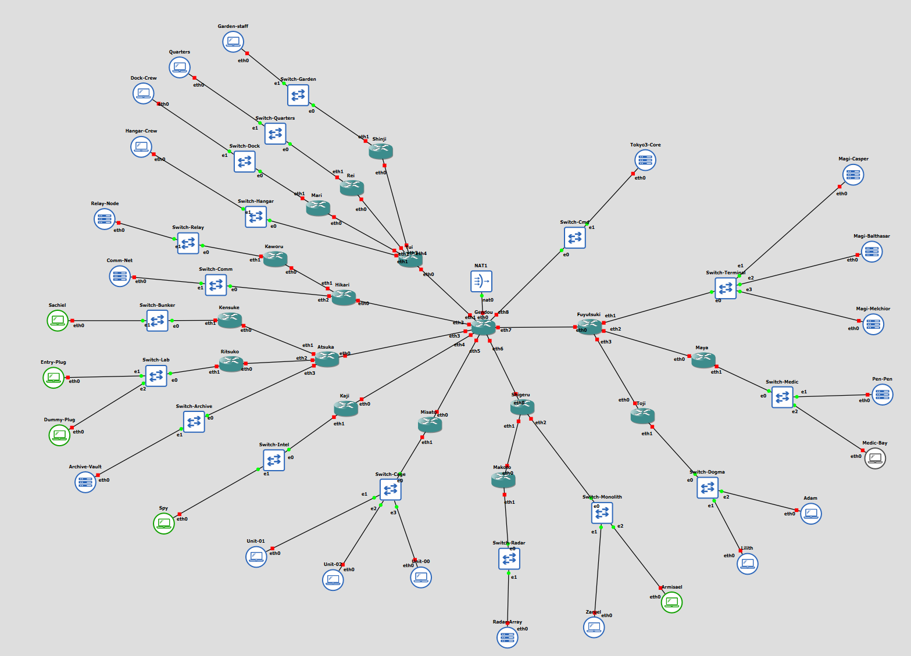

# Soal 1

## 1. Yang Diminta

1. Membuat tabel VLSM dengan membagi blok IP kelompok **10.92.0.0/16** untuk **17 LAN** dan **16 link antar-router**, diurutkan dari kebutuhan terbesar ke kebutuhan terkecil.
2. Membuat gambar pohon IP yang menunjukkan hierarki pemecahan subnet VLSM.
3. Melingkari **5 subnet** pada jalur dari **Dummy-Plug** ke **Armisael**.
4. Menulis penjelasan cara perhitungan satu subnet sebagai contoh dalam laporan.

## 2. Alur Pengerjaan VLSM

1. Urutkan LAN dan link berdasarkan kebutuhan IP dari yang terbesar hingga yang terkecil.
   - Jika jumlah kebutuhan sama, LAN didahulukan sebelum link antar-router.
2. Tentukan prefix **(/xx)** berdasarkan ukuran blok terkecil yang dapat menampung kebutuhan IP.
3. Isi parameter subnet secara berurutan:
   - Network ID
   - Gateway
   - IP terpakai
   - Broadcast ID
   - Sisa IP
4. Buat diagram pohon pemecahan subnet dari blok **/16** sampai subnet terkecil.

## 3. Topologi Jaringan

## 4. Diagram Pohon dan Pembagian IP

Diagram pohon berikut menampilkan pemecahan blok **10.92.0.0/16** menjadi subnet-subnet VLSM yang lebih kecil sesuai kebutuhan jaringan.

Pada diagram pohon tersebut, lima subnet yang ditandai dengan lingkaran merah merupakan subnet pada jalur **Dummy-Plug** menuju **Armisael**.

## 5. Cara Hitung Langsung

Contoh subnet: **Switch-Lab**

### Langkah 1: Menghitung Kebutuhan IP

| Perangkat | Jumlah IP |
|---|---:|
| Entry-Plug | 3 |
| Dummy-Plug | 2 |
| Gateway Ritsuko | 1 |
| **Total kebutuhan** | **6 IP usable** |

Perhitungan kebutuhan:

$$
3 + 2 + 1 = 6\text{ IP usable}
$$

### Langkah 2: Menentukan Blok dan Prefix

| Ukuran Blok | Prefix | Jumlah IP Usable | Keterangan |
|---|---:|---:|---|
| 4 IP | /30 | 2 | Kurang |
| 8 IP | /29 | 6 | Cukup |

Berdasarkan tabel di atas, subnet membutuhkan blok **8 IP**, sehingga digunakan:

- Prefix: **/29**
- Netmask: **255.255.255.248**

### Langkah 3: Menentukan Alamat IP

Diketahui subnet sebelumnya berakhir pada **10.92.4.47**.

| Parameter | Alamat |
|---|---|
| Network ID | 10.92.4.48 |
| Gateway | 10.92.4.49 |
| IP terpakai | 10.92.4.49-10.92.4.51 |
| Broadcast ID | 10.92.4.55 |
| Sisa IP | 10.92.4.52-10.92.4.54 |
