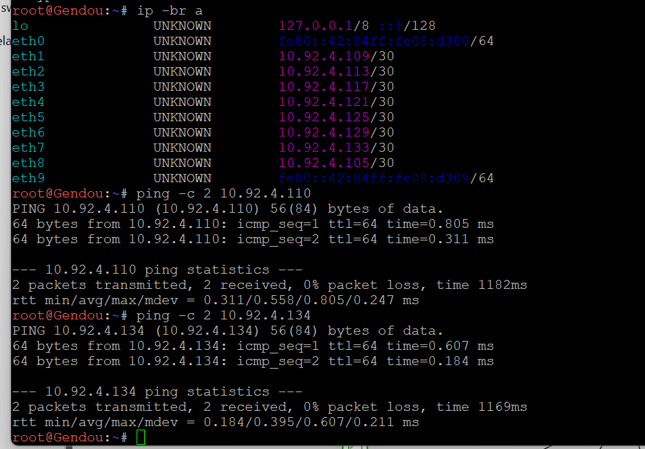

# Soal 2

## 1. Router Pusat: Gendou

Gendou menggunakan `dhclient` pada `eth0` untuk mendapatkan IP dari NAT1 dan mengatur alamat pada `eth1` sampai `eth8`.

```bash
nano script.sh
```

```bash
#!/bin/bash
sysctl -w net.ipv4.ip_forward=1

for i in eth1 eth2 eth3 eth4 eth5 eth6 eth7 eth8; do
    ip addr flush dev $i
    ip link set dev $i up
done

ip addr add 10.92.4.109/30 dev eth1
ip addr add 10.92.4.113/30 dev eth2
ip addr add 10.92.4.117/30 dev eth3
ip addr add 10.92.4.121/30 dev eth4
ip addr add 10.92.4.125/30 dev eth5
ip addr add 10.92.4.129/30 dev eth6
ip addr add 10.92.4.133/30 dev eth7
ip addr add 10.92.4.105/30 dev eth8
```

```bash
bash /root/script.sh
```

## 2. Router Cabang Menengah

### Yui

```bash
nano script.sh
```

```bash
#!/bin/bash
sysctl -w net.ipv4.ip_forward=1

for i in eth0 eth1 eth2 eth3 eth4; do
    ip addr flush dev $i
    ip link set dev $i up
done

ip addr add 10.92.4.110/30 dev eth0
ip addr add 10.92.3.1/25 dev eth1
ip addr add 10.92.4.137/30 dev eth2
ip addr add 10.92.4.141/30 dev eth3
ip addr add 10.92.4.145/30 dev eth4
```

```bash
bash /root/script.sh
```

### Hikari

```bash
nano script.sh
```

```bash
#!/bin/bash
sysctl -w net.ipv4.ip_forward=1

for i in eth0 eth1 eth2; do
    ip addr flush dev $i
    ip link set dev $i up
done

ip addr add 10.92.4.114/30 dev eth0
ip addr add 10.92.2.1/24 dev eth1
ip addr add 10.92.4.149/30 dev eth2
```

```bash
bash /root/script.sh
```

### Atsuka (Asuka)

```bash
nano script.sh
```

```bash
#!/bin/bash
sysctl -w net.ipv4.ip_forward=1

for i in eth0 eth1 eth2 eth3; do
    ip addr flush dev $i
    ip link set dev $i up
done

ip addr add 10.92.4.118/30 dev eth0
ip addr add 10.92.4.153/30 dev eth1
ip addr add 10.92.4.157/30 dev eth2
ip addr add 10.92.4.97/30 dev eth3
```

```bash
bash /root/script.sh
```

### Shigeru

```bash
nano script.sh
```

```bash
#!/bin/bash
sysctl -w net.ipv4.ip_forward=1

for i in eth0 eth1 eth2; do
    ip addr flush dev $i
    ip link set dev $i up
done

ip addr add 10.92.4.130/30 dev eth0
ip addr add 10.92.4.161/30 dev eth1
ip addr add 10.92.4.89/29 dev eth2
```

```bash
bash /root/script.sh
```

### Fuyutsuki

```bash
nano script.sh
```

```bash
#!/bin/bash
sysctl -w net.ipv4.ip_forward=1

for i in eth0 eth1 eth2 eth3; do
    ip addr flush dev $i
    ip link set dev $i up
done

ip addr add 10.92.4.134/30 dev eth0
ip addr add 10.92.4.65/29 dev eth1
ip addr add 10.92.4.165/30 dev eth2
ip addr add 10.92.4.169/30 dev eth3
```

```bash
bash /root/script.sh
```

## 3. Router Leaf / Ujung

### Mari

```bash
nano script.sh
```

```bash
#!/bin/bash
sysctl -w net.ipv4.ip_forward=1

for i in eth0 eth1; do ip addr flush dev $i; ip link set dev $i up; done
ip addr add 10.92.4.138/30 dev eth0
ip addr add 10.92.4.33/28 dev eth1
```

```bash
bash /root/script.sh
```

### Rei

```bash
nano script.sh
```

```bash
#!/bin/bash
sysctl -w net.ipv4.ip_forward=1

for i in eth0 eth1; do ip addr flush dev $i; ip link set dev $i up; done
ip addr add 10.92.4.142/30 dev eth0
ip addr add 10.92.0.1/23 dev eth1
```

```bash
bash /root/script.sh
```

### Shinji

```bash
nano script.sh
```

```bash
#!/bin/bash
sysctl -w net.ipv4.ip_forward=1

for i in eth0 eth1; do ip addr flush dev $i; ip link set dev $i up; done
ip addr add 10.92.4.146/30 dev eth0
ip addr add 10.92.4.1/27 dev eth1
```

```bash
bash /root/script.sh
```

### Kaworu

```bash
nano script.sh
```

```bash
#!/bin/bash
sysctl -w net.ipv4.ip_forward=1

for i in eth0 eth1; do ip addr flush dev $i; ip link set dev $i up; done
ip addr add 10.92.4.150/30 dev eth0
ip addr add 10.92.3.225/27 dev eth1
```

```bash
bash /root/script.sh
```

### Kensuke

```bash
nano script.sh
```

```bash
#!/bin/bash
sysctl -w net.ipv4.ip_forward=1

for i in eth0 eth1; do ip addr flush dev $i; ip link set dev $i up; done
ip addr add 10.92.4.154/30 dev eth0
ip addr add 10.92.3.129/26 dev eth1
```

```bash
bash /root/script.sh
```

### Ritsuko

```bash
nano script.sh
```

```bash
#!/bin/bash
sysctl -w net.ipv4.ip_forward=1

for i in eth0 eth1; do ip addr flush dev $i; ip link set dev $i up; done
ip addr add 10.92.4.158/30 dev eth0
ip addr add 10.92.4.49/29 dev eth1
```

```bash
bash /root/script.sh
```

### Kaji

```bash
nano script.sh
```

```bash
#!/bin/bash
sysctl -w net.ipv4.ip_forward=1

for i in eth0 eth1; do ip addr flush dev $i; ip link set dev $i up; done
ip addr add 10.92.4.122/30 dev eth0
ip addr add 10.92.4.101/30 dev eth1
```

```bash
bash /root/script.sh
```

### Misato

```bash
nano script.sh
```

```bash
#!/bin/bash
sysctl -w net.ipv4.ip_forward=1

for i in eth0 eth1; do ip addr flush dev $i; ip link set dev $i up; done
ip addr add 10.92.4.126/30 dev eth0
ip addr add 10.92.4.73/29 dev eth1
```

```bash
bash /root/script.sh
```

### Makoto

```bash
nano script.sh
```

```bash
#!/bin/bash
sysctl -w net.ipv4.ip_forward=1

for i in eth0 eth1; do ip addr flush dev $i; ip link set dev $i up; done
ip addr add 10.92.4.162/30 dev eth0
ip addr add 10.92.4.57/29 dev eth1
```

```bash
bash /root/script.sh
```

### Maya

```bash
nano script.sh
```

```bash
#!/bin/bash
sysctl -w net.ipv4.ip_forward=1

for i in eth0 eth1; do ip addr flush dev $i; ip link set dev $i up; done
ip addr add 10.92.4.166/30 dev eth0
ip addr add 10.92.3.193/27 dev eth1
```

```bash
bash /root/script.sh
```

### Toji

```bash
nano script.sh
```

```bash
#!/bin/bash
sysctl -w net.ipv4.ip_forward=1

for i in eth0 eth1; do ip addr flush dev $i; ip link set dev $i up; done
ip addr add 10.92.4.170/30 dev eth0
ip addr add 10.92.4.81/29 dev eth1
```

```bash
bash /root/script.sh
```

## 4. Menjalankan Skrip Otomatis Saat GNS3 Dimulai

Tambahkan konfigurasi berikut ke `/etc/network/interfaces` pada setiap router agar skrip dijalankan saat antarmuka `eth0` aktif:

```text
auto eth0
iface eth0 inet manual
    up bash /root/script.sh
```


## 5. Verifikasi Koneksi

### Langkah 1: Periksa Alamat IP

Jalankan perintah berikut pada setiap router untuk memastikan antarmuka dan alamat IP sudah aktif:

```bash
ip -br a
```

### Langkah 2: Uji Koneksi dengan Ping

Jalankan perintah ping dari router asal ke alamat router tujuan berikut.

#### Dari Gendou

- Yui: `ping -c 2 10.92.4.110`
- Hikari: `ping -c 2 10.92.4.114`
- Atsuka: `ping -c 2 10.92.4.118`
- Kaji: `ping -c 2 10.92.4.122`
- Misato: `ping -c 2 10.92.4.126`
- Shigeru: `ping -c 2 10.92.4.130`
- Fuyutsuki: `ping -c 2 10.92.4.134`

#### Dari Yui

- Mari: `ping -c 2 10.92.4.138`
- Rei: `ping -c 2 10.92.4.142`
- Shinji: `ping -c 2 10.92.4.146`

#### Dari Hikari

- Kaworu: `ping -c 2 10.92.4.150`

#### Dari Atsuka

- Kensuke: `ping -c 2 10.92.4.154`
- Ritsuko: `ping -c 2 10.92.4.158`

#### Dari Shigeru

- Makoto: `ping -c 2 10.92.4.162`

#### Dari Fuyutsuki

- Maya: `ping -c 2 10.92.4.166`
- Toji: `ping -c 2 10.92.4.170`

Berikut dokumentasi pemeriksaan alamat IP dan pengujian koneksi dari Gendou:

