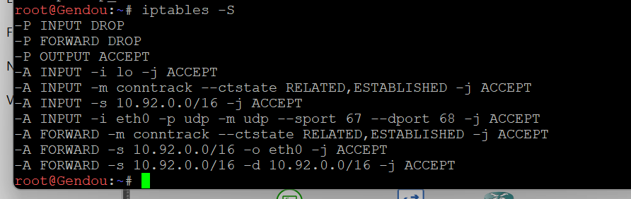

# Soal 5: Firewall Gendou

## 1. Menyiapkan Skrip Firewall

Jalankan perintah berikut di console Gendou untuk membuat `/root/gendo.sh`, menyalinnya ke `/root/script.sh`, dan menjalankan skrip:

```bash
cat << 'EOF' > /root/gendo.sh
#!/bin/bash
sysctl -w net.ipv4.ip_forward=1

for i in eth1 eth2 eth3 eth4 eth5 eth6 eth7 eth8; do
    ip addr flush dev $i
    ip link set dev $i up
done

ip addr add 10.92.4.109/30 dev eth1
ip addr add 10.92.4.113/30 dev eth2
ip addr add 10.92.4.117/30 dev eth3
ip addr add 10.92.4.121/30 dev eth4
ip addr add 10.92.4.125/30 dev eth5
ip addr add 10.92.4.129/30 dev eth6
ip addr add 10.92.4.133/30 dev eth7
ip addr add 10.92.4.105/30 dev eth8

# Cabang Yui (10.92.4.110)
ip route replace 10.92.0.0/23 via 10.92.4.110
ip route replace 10.92.3.0/25 via 10.92.4.110
ip route replace 10.92.4.0/27 via 10.92.4.110
ip route replace 10.92.4.32/28 via 10.92.4.110
ip route replace 10.92.4.136/30 via 10.92.4.110
ip route replace 10.92.4.140/30 via 10.92.4.110
ip route replace 10.92.4.144/30 via 10.92.4.110

# Cabang Hikari (10.92.4.114)
ip route replace 10.92.2.0/24 via 10.92.4.114
ip route replace 10.92.3.224/27 via 10.92.4.114
ip route replace 10.92.4.148/30 via 10.92.4.114

# Cabang Atsuka (10.92.4.118) — Link Kensuke & Ritsuko diringkas ke /29
ip route replace 10.92.3.128/26 via 10.92.4.118
ip route replace 10.92.4.48/29 via 10.92.4.118
ip route replace 10.92.4.96/30 via 10.92.4.118
ip route replace 10.92.4.152/29 via 10.92.4.118

# Cabang Kaji (10.92.4.122)
ip route replace 10.92.4.100/30 via 10.92.4.122

# Cabang Misato (10.92.4.126)
ip route replace 10.92.4.72/29 via 10.92.4.126

# Cabang Shigeru (10.92.4.130)
ip route replace 10.92.4.56/29 via 10.92.4.130
ip route replace 10.92.4.88/29 via 10.92.4.130
ip route replace 10.92.4.160/30 via 10.92.4.130

# Cabang Fuyutsuki (10.92.4.134)
ip route replace 10.92.3.192/27 via 10.92.4.134
ip route replace 10.92.4.64/29 via 10.92.4.134
ip route replace 10.92.4.80/29 via 10.92.4.134
ip route replace 10.92.4.164/30 via 10.92.4.134
ip route replace 10.92.4.168/30 via 10.92.4.134

# NAT Masquerade hanya untuk prefix internal 10.92.0.0/16 keluar via eth0 (NAT1)
iptables -t nat -F POSTROUTING
iptables -t nat -A POSTROUTING -s 10.92.0.0/16 -o eth0 -j MASQUERADE

# Firewall Filter Rules (Soal 5)
iptables -F
iptables -X
iptables -P INPUT DROP
iptables -P FORWARD DROP
iptables -P OUTPUT ACCEPT

# INPUT: Loopback, Established/Related, Internal ke Gendou, dan DHCP dari NAT1
iptables -A INPUT -i lo -j ACCEPT
iptables -A INPUT -m conntrack --ctstate ESTABLISHED,RELATED -j ACCEPT
iptables -A INPUT -s 10.92.0.0/16 -j ACCEPT
iptables -A INPUT -i eth0 -p udp --sport 67 --dport 68 -j ACCEPT

# FORWARD: Established/Related, Internal ke Internet, dan Antar-LAN Internal
iptables -A FORWARD -m conntrack --ctstate ESTABLISHED,RELATED -j ACCEPT
iptables -A FORWARD -s 10.92.0.0/16 -o eth0 -j ACCEPT
iptables -A FORWARD -s 10.92.0.0/16 -d 10.92.0.0/16 -j ACCEPT
EOF

chmod +x /root/gendo.sh
cp /root/gendo.sh /root/script.sh
bash /root/gendo.sh
```

## 2. Pengujian Firewall

### Memeriksa Aturan di Gendou

Di console Gendou, tampilkan daftar aturan firewall aktif:

```bash
iptables -S
```

Pastikan kebijakan `INPUT` dan `FORWARD` menggunakan `DROP`, serta aturan `ACCEPT` yang telah ditambahkan muncul pada daftar.


### Menguji Koneksi dari Armisael

Jalankan perintah berikut untuk menguji akses internet dan koneksi ke Gendou:

```bash
ping -c 3 8.8.8.8
ping -c 2 10.92.4.109
```
