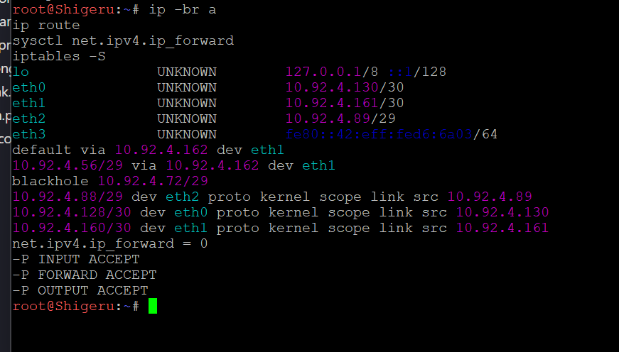
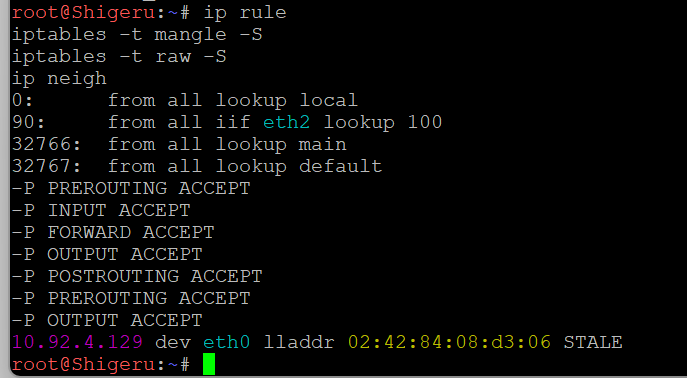
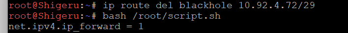
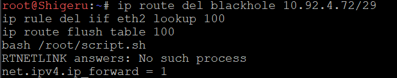
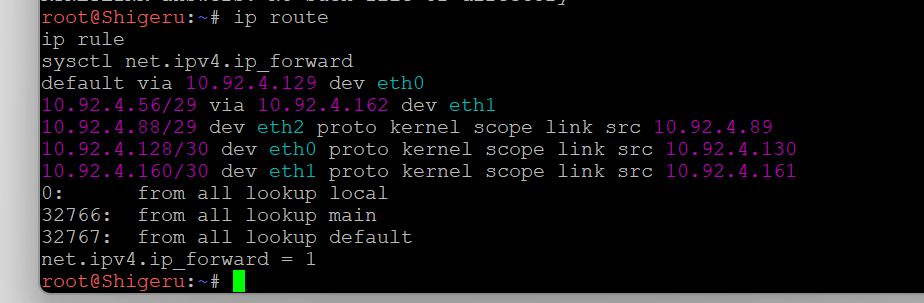
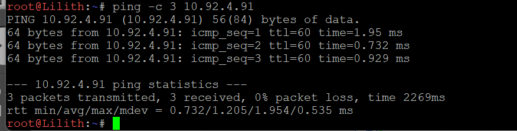

# Soal 9: Pengujian Breaker Routing

## 1. Menyiapkan Skrip

Buka file skrip breaker di router yang ditentukan, lalu salin isi skrip ke dalamnya:

```bash
nano /root/break_routing.sh
```

## 2. Menjalankan Skrip

Jalankan skrip breaker:

```bash
bash /root/break_routing.sh
```

## 3. Mengumpulkan Diagnostik dari Shigeru

Jalankan perintah berikut di console Shigeru untuk memeriksa antarmuka, tabel routing, status IP forwarding, dan aturan firewall:

```bash
ip -br a
ip route
sysctl net.ipv4.ip_forward
iptables -S
```



```bash
ip rule
iptables -t mangle -S
iptables -t raw -S
ip neigh
```


## 4. Menguji Koneksi Sebelum Perbaikan

Sebelum melakukan perbaikan, jalankan dan dokumentasikan hasil ping berikut:

### Dari Lilith

```bash
ping -c 3 10.92.4.91
```


### Dari Armisael

```bash
ping -c 3 10.92.4.89
```


## 5. Analisis Penyebab Gangguan

### IP Forwarding Dinonaktifkan

Nilai `net.ipv4.ip_forward = 0` membuat Shigeru tidak meneruskan paket antar-interface. Paket ICMP dari Lilith (`10.92.4.82`) dapat tiba di `eth0` Shigeru, tetapi tidak diteruskan melalui `eth2` menuju Armisael.

Armisael masih dapat melakukan ping ke `10.92.4.89` karena alamat tersebut adalah milik interface Shigeru yang terhubung langsung ke Armisael. Trafik ini ditujukan ke Shigeru sendiri, sehingga tidak memerlukan penerusan paket antar-interface.

### Default Route Shigeru Salah

Default route Shigeru diarahkan ke Makoto (`10.92.4.162` melalui `eth1`), padahal seharusnya diarahkan ke Gendou (`10.92.4.129` melalui `eth0`). Akibatnya, paket balasan menuju jaringan lain dapat terkirim ke Makoto, yang tidak memiliki rute keluar yang sesuai.

### Rute Blackhole pada Subnet Switch-Cage

Rute blackhole untuk subnet Switch-Cage (`10.92.4.72/29`), tempat Unit-01, Unit-02, dan Unit-00 berada, menyebabkan paket menuju subnet tersebut dibuang oleh kernel tanpa pesan kesalahan.

### Policy-Based Routing pada `eth2`

Aturan policy routing `90: from all iif eth2 lookup 100` mengarahkan paket yang masuk melalui `eth2` ke tabel routing 100, bukan tabel `main`. Akibatnya, paket balasan dari Armisael dapat gagal menemukan rute kembali ke Gendou.

## 6. Langkah Perbaikan

Jalankan perintah berikut di console Shigeru:

```bash
ip route del blackhole 10.92.4.72/29
ip rule del iif eth2 lookup 100
ip route flush table 100
bash /root/script.sh
```

- `ip route del blackhole 10.92.4.72/29`: menghapus rute blackhole agar paket menuju subnet Switch-Cage tidak dibuang.
- `ip rule del iif eth2 lookup 100` dan `ip route flush table 100`: menghapus aturan policy routing pada `eth2` dan membersihkan tabel 100 agar paket balasan diproses menggunakan tabel `main`.
- `bash /root/script.sh`: menjalankan ulang konfigurasi Shigeru untuk mengaktifkan IP forwarding, memulihkan alamat interface, dan mengembalikan default route ke Gendou (`10.92.4.129` melalui `eth0`).




## 7. Verifikasi Setelah Perbaikan

### Di Shigeru

Pastikan rute blackhole sudah tidak ada, default route mengarah ke Gendou, dan IP forwarding aktif:

```bash
ip route
ip rule
sysctl net.ipv4.ip_forward
```


### Di Lilith

Uji kembali koneksi dari Lilith ke Armisael:

```bash
ping -c 3 10.92.4.91
```

